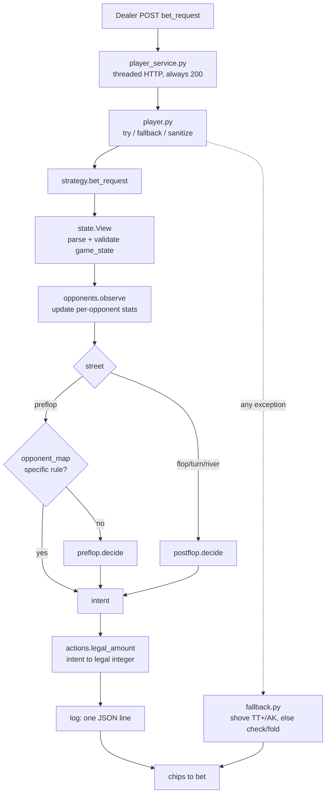
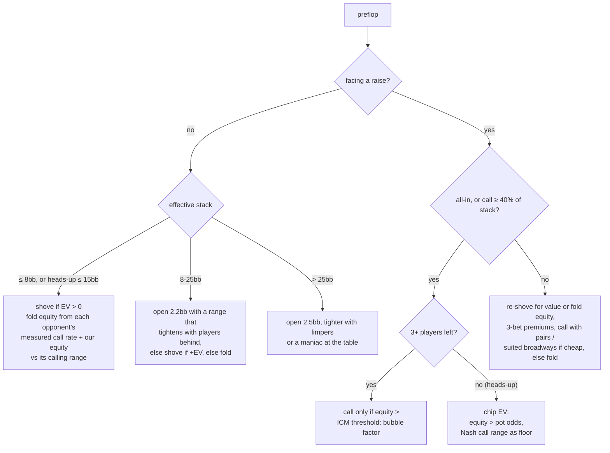
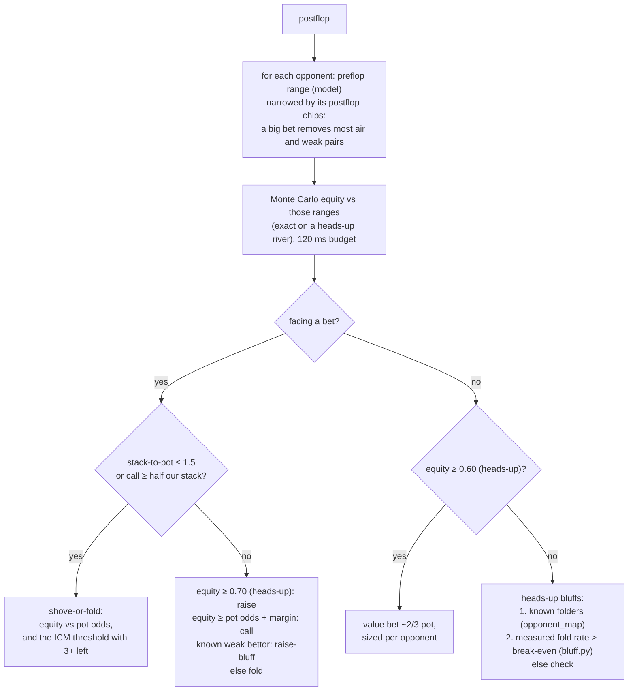
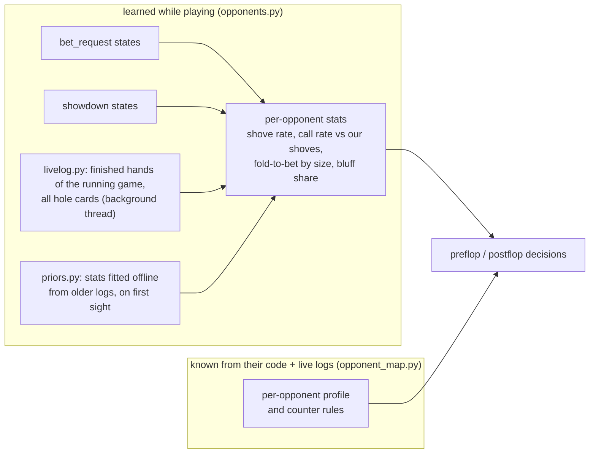
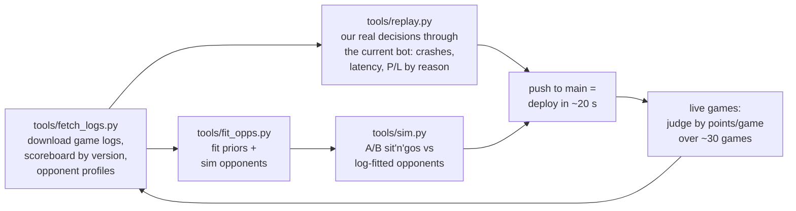

# nontekik: a Lean Poker bot

A No-Limit Texas Hold'em sit'n'go bot for [Lean Poker](https://www.leanpoker.org). The dealer POSTs a
`game_state` JSON to our HTTP service, and we answer with the number of chips to add to the pot. The
bot is plain Python 3.11 with the standard library only. All poker code is written in this repo (evaluator,
equity, tables).

## The game, and what it rewards

| Fact | Consequence for the strategy |
|---|---|
| 4 bots, 1000 chips each. Blinds start at 2/4 and step up every 10 hands (2, 3, 5, 10, 15, 20, 30, 40, 50, 70, 100, ...) | A game lasts ~100 hands. Stacks are deep at first, but most decisions that matter come at 5-25 big blinds, so preflop shove/fold play dominates. |
| Scoring: **1st = 5 points, 2nd = 3, 3rd/4th = 0** | 2nd place is worth 60% of a win. Busting 3rd scores nothing, so chips are worth *less than linear*: with 3+ players left we need more equity to risk our stack (ICM). Heads-up, 2nd is locked and only chips matter. |
| Games are cut at ~3 minutes and ranked by chips | Near the cutoff, the chip leader protects its lead and the others gamble. |
| An exception, a bad return value or a timeout bans us for that game | A safety layer wraps everything. A dumb but legal answer beats a crash. |
| Opponents redeploy every few minutes and read our public code | Opponent knowledge is kept in one place (`bot/opponent_map.py`) and re-checked against live logs. Mixed decisions use an unpredictable RNG. |

## How one decision is made



Strategy code never returns raw numbers. It returns an **intent** (`FOLD`, `CHECK`, `CALL`,
`RAISE_TO(x)`, `ALL_IN`), and `actions.legal_amount` turns it into a legal integer: clamped to our
stack, minimum raises respected. Every decision logs one JSON line (hand, board, equity, required
equity, reason code, ms) to stderr, which shows up in the Lean Poker log view.

## Preflop: decided by stack depth

Preflop is almost all table lookups: `tools/gen_tables.py` precomputes a 169×169 heads-up equity
matrix and equity against 1-5 random hands. So a decision takes microseconds and the time budget goes
to postflop Monte Carlo.



* **Shove EV**:
  `EV = P(all fold) * pot + P(called) * (eq * final_pot - risk)`.
  The fold probability comes from each opponent's measured call rate. Our equity is a table lookup
  against that opponent's calling range.
* **ICM threshold**: with 3+ players left, calling an all-in must gain tournament points, not chips.
  `required equity = (points if we fold - points if we lose) / (points if we win - points if we lose)`,
  using Malmuth-Harville ICM with 5/3/0 payouts (`tournament.py`). Four-handed with equal stacks this
  asks for ~57% equity instead of ~50%; at a bubble with a medium stack, up to ~70%. Shove ranges barely
  change, but calling ranges roughly halve, so we let the others bust each other.
* **Heads-up**: 2nd place is locked, so it is pure chip EV, with Nash push/fold ranges as a floor
  (e.g. at 10bb, shove 58% of hands from the small blind and call with 38% in the big blind).

## Postflop: equity against realistic ranges



* **Range narrowing** (`postflop.villain_combos`): every combo in the opponent's preflop range is
  classed on this board as air, draw, weak pair, top pair or two pair+. It is then kept with a
  probability that depends on how much the opponent has bet since the flop. This was the single
  biggest fix: before it, the bot called down with ace-high against opponents betting every street.
* **Margin**: call with equity ≥ pot odds + 0.03 (+0.02 per extra opponent). The margin shrinks against
  maniacs and grows when a nit bets big.
* **Survival**: with 3+ players left, a postflop bluff is never an all-in, and every stack-risking
  call or shove also has to clear the ICM threshold.

## What we know about each opponent

Two kinds of opponent knowledge feed the decisions:



* **Learned** (`opponents.py`): counts smoothed with a Beta prior, so an unseen opponent gets sensible
  defaults (calls a shove with its top 35%, shoves its top 30%), and its real behaviour takes over after
  ~8 hands. When an opponent's version string changes, its stats decay to 20%. Derived labels
  (maniac, folder, station, nit) adjust margins and bluffing.
* **Known** (`opponent_map.py`): every opponent-specific rule lives in this one file. Each was read from
  the opponent's public source and checked against live logs:

| Opponent | What it does | Our counter |
|---|---|---|
| **bpex** | Pushes/folds at ≤ 15bb by Chen score; deeper it opens ~4.5bb. Postflop it bets with ≥ 0.55 equity vs a random hand and calls our bets that are 1.05-1.45× pot as bluffs. | Bluff it just under pot (0.96×); value-bet thinner at 0.7 pot. (Tried and reverted: exact preflop ranges + deep 3-bets against its opens.) |
| **megistekik** | Calls our small heads-up bets light, but treats bets ≥ ½ pot **and** ≥ ¼ of its stack as value and folds to them. | Bluff only at its "big bet" line; value-bet under it. |
| **nontechyk** | Bets whenever its equity vs a *random* hand is ≥ 0.6, checks otherwise, and needs ~0.6 to call a big bet. Its small bets are ~44% air. It calls a lone all-in based on how often we shove. | Bet ¾ pot whenever it checks to us (live: 42 of 43 folds); raise its small bets; value-bet it small; shove wide preflop when it is the only player left (≤ 40bb), keeping our shove rate low. |

## Code map

| File | Role |
|---|---|
| `player_service.py` | HTTP service; threaded, always answers 200. |
| `player.py` | Entry point: version string, exception fallback, return-value sanitizing. |
| `bot/strategy.py` | One bet request end to end (see the first diagram). |
| `bot/state.py` | Typed view of `game_state`: call amount, effective stack, positions, who is behind us. |
| `bot/actions.py` | Intents → legal integers. |
| `bot/preflop.py` | Preflop zones, shove EV, ICM calls, heads-up Nash floors. |
| `bot/postflop.py` | Range narrowing, equity, bet / call / raise / bluff decisions. |
| `bot/bluff.py` | Generic bluffing from measured fold rates; draw detection. |
| `bot/opponent_map.py` | Everything opponent-specific: profiles and counter rules. |
| `bot/opponents.py` | Learned per-opponent statistics and archetypes. |
| `bot/priors.py`, `bot/data/opp_priors.json` | Offline-fitted starting stats per opponent. |
| `bot/livelog.py` | Background reader of the running game's finished hands. |
| `bot/tournament.py` | ICM (5/3/0), per-game thinking time, 3-minute cutoff mode. |
| `bot/equity.py` | Range-weighted Monte Carlo equity with a hard deadline. |
| `bot/tables.py`, `bot/data/preflop.json` | Preflop equity tables and hand percentiles. |
| `bot/evaluator.py`, `bot/cards.py` | 7-card hand evaluator (lookup tables) and card parsing. |
| `bot/config.py` | All generic tunables, grouped and commented. |
| `bot/log.py`, `bot/fallback.py` | Decision log lines; last-resort strategy. |

## Tools and the improvement loop



```bash
python3 tools/fetch_logs.py --last 60          # scoreboard + opponent profiles from the live tournament
python3 tools/replay.py --last 20              # crash/latency check on real states; P&L by reason code
python3 tools/fit_opps.py                      # refresh priors and sim opponents from the cached logs
python3 tools/sim.py --a current --b baseline --n 1000   # A/B against log-fitted opponents
python3 tools/gen_tables.py                    # rebuild preflop tables (only if the evaluator changes)
```

Run the bot locally:

```bash
PORT=9000 python3 player_service.py
curl -d 'action=version' localhost:9000
```

## Lessons from the event

* **Live results decide, the simulator only filters.** Several sim "wins" of ±0.1 points/game were noise
  or reversed live. We judge a change by points per game over ~30 live games.
* **Postflop discipline mattered more than clever preflop.** Narrowing ranges by bet size turned the
  biggest leak (calling down vs bettors) into folds worth ~350 BB over 19 games.
* **Survival is points.** ICM-aware calling raised 2nd-place finishes; 2nd is worth 60% of a win.
* **Opponents read your code.** Counters stay valid for minutes, not hours. Keep them in one file, check
  them against live logs, and expect the other side to adapt.
